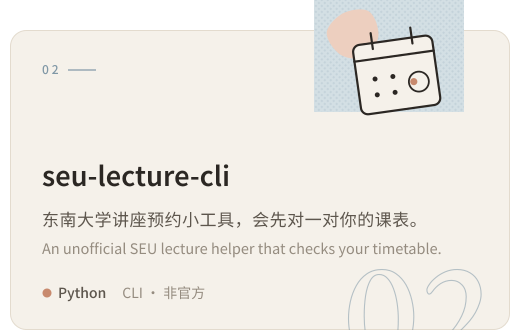

  <picture>
    <source media="(prefers-color-scheme: dark)" srcset="assets/header-dark.svg">
    
  </picture>

### 作品 · Projects

<!-- the two cards share one line: any whitespace between them would push the second onto the next -->

  <a href="https://github.com/wynter-yaxley/agent-control-bridge"><picture><source media="(prefers-color-scheme: dark)" srcset="assets/card-bridge-dark.svg"></picture></a><a href="https://github.com/wynter-yaxley/seu-lecture-cli"><picture><source media="(prefers-color-scheme: dark)" srcset="assets/card-lecture-dark.svg"></picture></a>

### 近来 · Lately

- 给 AI Agent 搭几座通往桌面应用的小桥。 Building small bridges between AI agents and desktop apps.
- 写些让日常琐事省点力气的命令行小工具。 Writing little command-line tools that take the edge off everyday chores.
- 想到什么就先记下来，挑最有意思的那个先做。 Jotting ideas down, then starting with whichever seems most fun.

### 常用 · Toolbox

  <picture>
    <source media="(prefers-color-scheme: dark)" srcset="assets/toolbox-dark.svg">
    
  </picture>

 

谢谢你来看看 · Thanks for stopping by

