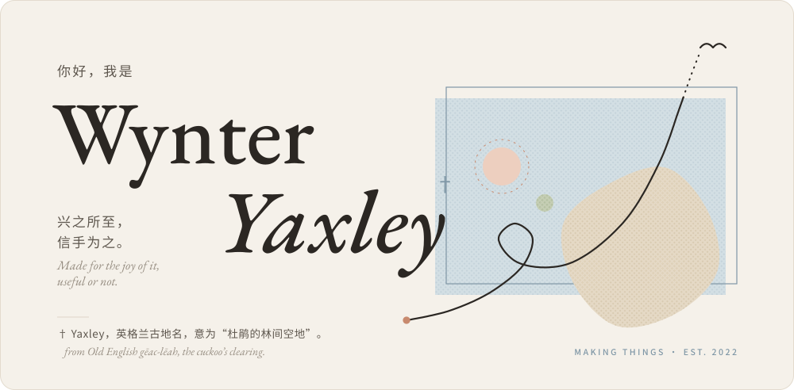
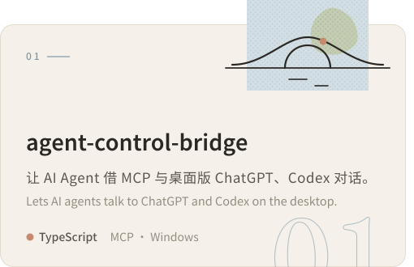
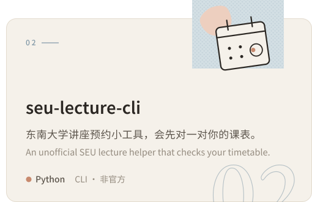

  <picture>
    <source media="(max-width: 600px) and (prefers-color-scheme:dark)" srcset="assets/header-mobile-dark.b83b064d.svg">
    <source media="(max-width: 600px)" srcset="assets/header-mobile-light.83ce6b1f.svg">
    <source media="(prefers-color-scheme: dark)" srcset="assets/header-dark.353a568c.svg">
    
  </picture>

### 作品 · Projects

<!-- the two cards share one line: any whitespace between them would push the second onto the next.
     Below 600px each picture switches to its upright drawing, and the cards to full width, so they stack.
     The phone sources spell "prefers-color-scheme:dark" without a space on purpose: GitHub's themed-picture
     script rewrites any media it recognises as a theme query, which would throw the width condition away. -->

  <a href="https://github.com/wynter-yaxley/agent-control-bridge"><picture><source media="(max-width: 600px) and (prefers-color-scheme:dark)" srcset="assets/card-bridge-mobile-dark.4dfe2ca3.svg" width="100%"><source media="(max-width: 600px)" srcset="assets/card-bridge-mobile-light.6e4a7fa5.svg" width="100%"><source media="(prefers-color-scheme: dark)" srcset="assets/card-bridge-dark.e2e55ed9.svg"></picture></a><a href="https://github.com/wynter-yaxley/seu-lecture-cli"><picture><source media="(max-width: 600px) and (prefers-color-scheme:dark)" srcset="assets/card-lecture-mobile-dark.e6691d65.svg" width="100%"><source media="(max-width: 600px)" srcset="assets/card-lecture-mobile-light.18cb4d9a.svg" width="100%"><source media="(prefers-color-scheme: dark)" srcset="assets/card-lecture-dark.d32e6ba7.svg"></picture></a>

### 足迹 · On GitHub

  <picture>
    <source media="(max-width: 600px) and (prefers-color-scheme:dark)" srcset="assets/stats-mobile-dark.151750a1.svg">
    <source media="(max-width: 600px)" srcset="assets/stats-mobile-light.370908c9.svg">
    <source media="(prefers-color-scheme: dark)" srcset="assets/stats-dark.af6b10ee.svg">
    
  </picture>

### 常用 · Toolbox

  <picture>
    <source media="(max-width: 600px) and (prefers-color-scheme:dark)" srcset="assets/toolbox-mobile-dark.0859247c.svg">
    <source media="(max-width: 600px)" srcset="assets/toolbox-mobile-light.32ee543b.svg">
    <source media="(prefers-color-scheme: dark)" srcset="assets/toolbox-dark.f78dde9b.svg">
    
  </picture>

