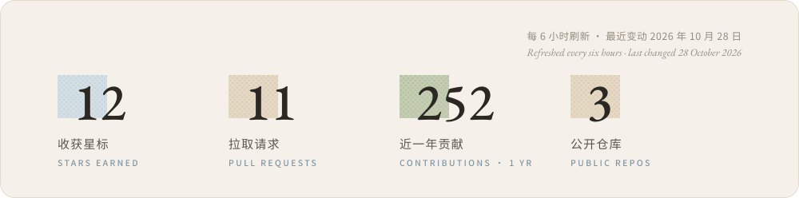

  <picture>
    <source media="(prefers-color-scheme: dark)" srcset="assets/header-dark.06a0a6b7.svg">
    
  </picture>

### 作品 · Projects

<!-- the two cards share one line: any whitespace between them would push the second onto the next -->

  <a href="https://github.com/wynter-yaxley/agent-control-bridge"><picture><source media="(prefers-color-scheme: dark)" srcset="assets/card-bridge-dark.e2e55ed9.svg"></picture></a><a href="https://github.com/wynter-yaxley/seu-lecture-cli"><picture><source media="(prefers-color-scheme: dark)" srcset="assets/card-lecture-dark.d32e6ba7.svg"></picture></a>

### 足迹 · On GitHub

  <picture>
    <source media="(prefers-color-scheme: dark)" srcset="assets/stats-dark.8b09f43e.svg">
    
  </picture>

### 常用 · Toolbox

  <picture>
    <source media="(prefers-color-scheme: dark)" srcset="assets/toolbox-dark.e9aa827a.svg">
    
  </picture>

