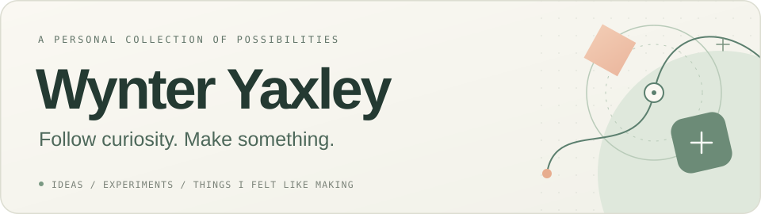

  

  <strong>好奇什么，就动手试试。</strong> 
  I make things out of curiosity — sometimes useful, sometimes just for fun.

  <samp>
    <a href="https://github.com/wynter-yaxley?tab=repositories">PROJECTS · 项目</a>
    &nbsp; / &nbsp;
    <a href="https://github.com/wynter-yaxley?tab=stars">DISCOVERIES · 收藏</a>
  </samp>

 

## Projects · 兴趣作品

<table>
  <tr>
    <td width="50%" valign="top">
      
      <h3><a href="https://github.com/wynter-yaxley/agent-control-bridge">agent-control-bridge</a></h3>
      
让 AI Agent 通过 MCP 使用桌面应用中的 ChatGPT 与 Codex 对话。

      
A bridge between AI agents and desktop conversations.

    </td>
    <td width="50%" valign="top">
      
      <h3><a href="https://github.com/wynter-yaxley/seu-lecture-cli">seu-lecture-cli</a></h3>
      
东南大学讲座预约小工具，支持课表冲突检查。非官方。

      
An unofficial SEU lecture CLI that checks your timetable.

    </td>
  </tr>
</table>

 

  这里放着一些小实验、实用工具，以及临时起意的想法。 
  A collection of things I wanted to try, learn, or make useful.

